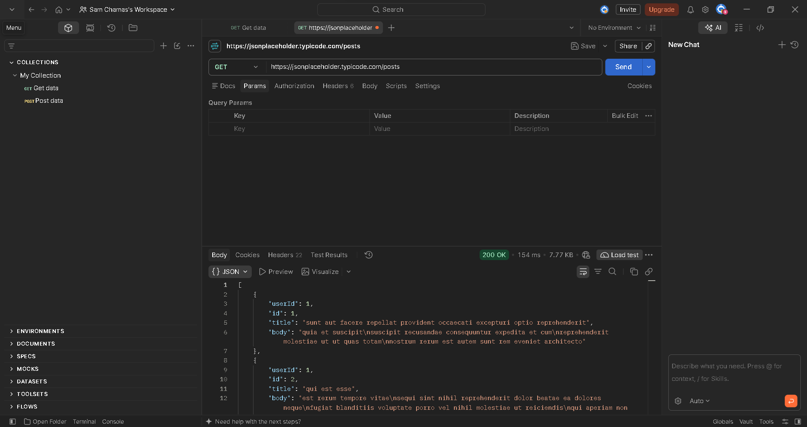
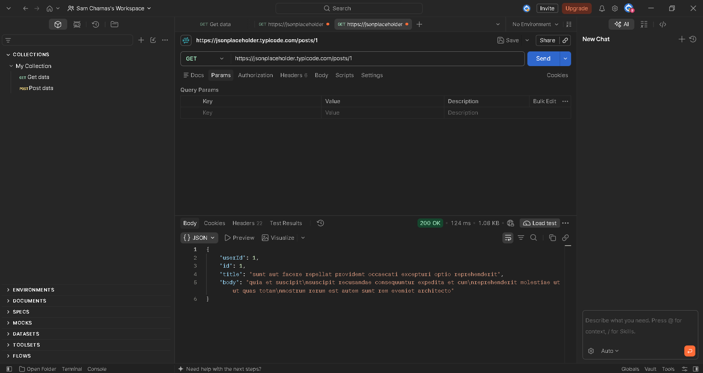
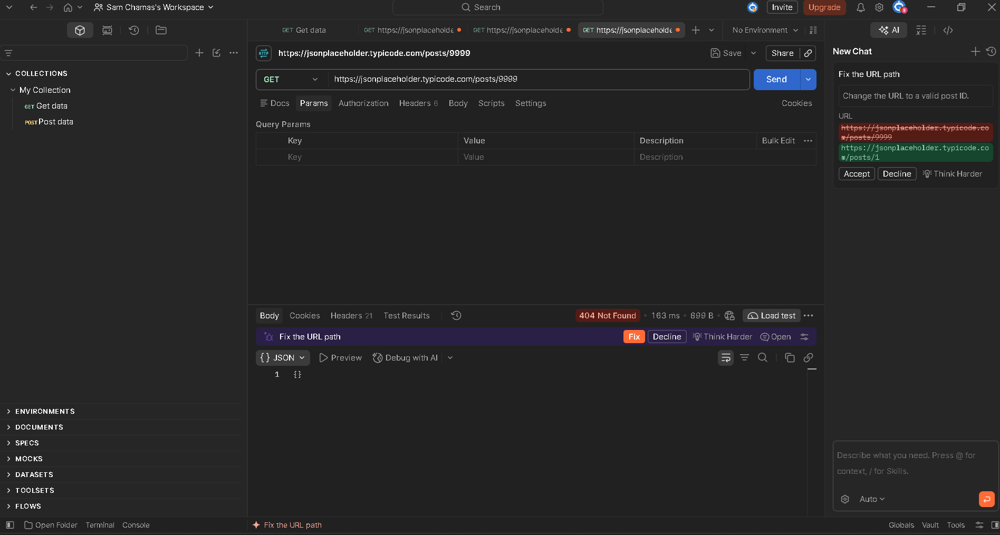
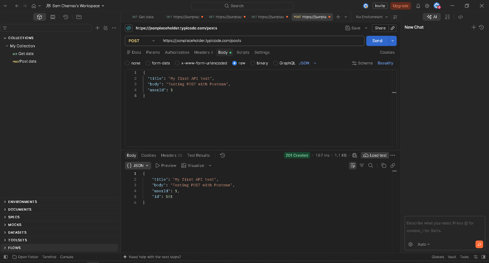
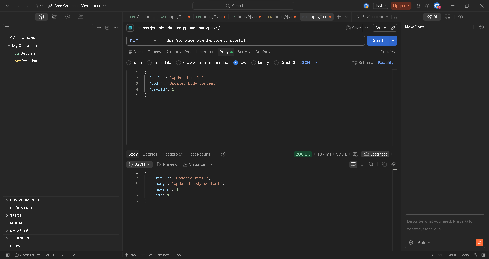
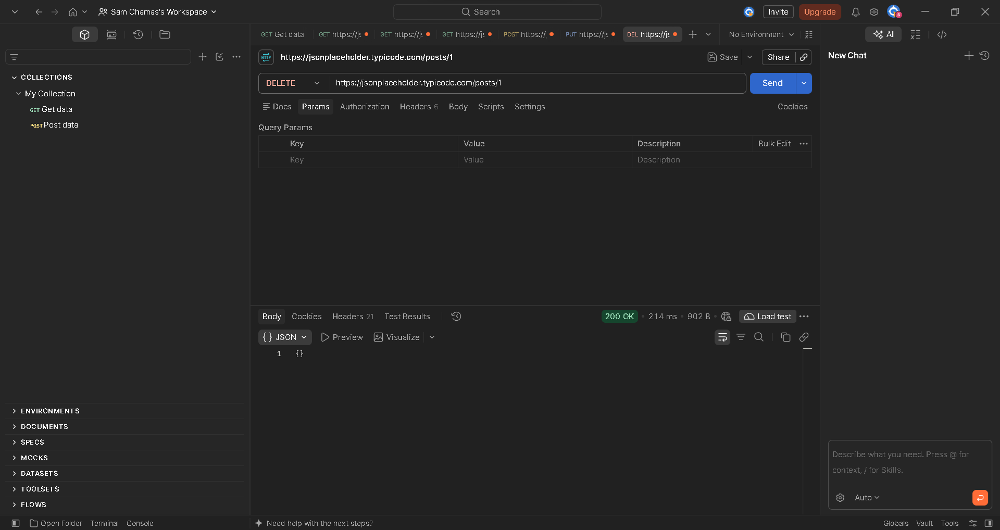

# API Testing with Postman - JSONPlaceholder

**Project:** api-testing-project1
**Base URL:** https://jsonplaceholder.typicode.com
**Tool:** Postman

## Test Results - 6/6 PASS

| # | Test Case | Method | Endpoint | Expected | Actual | Result |
| --- | --- | --- | --- | --- | --- | --- |
| 1 | Get All Posts | GET | /posts | 200 OK | 200 OK | PASS |
| 2 | Get Single Post | GET | /posts/1 | 200 OK | 200 OK, id: 1 | PASS |
| 3 | Get Invalid Post | GET | /posts/9999 | 404 Not Found | 404 Not Found, {} | PASS |
| 4 | Create New Post | POST | /posts | 201 Created | 201 Created, id: 101 | PASS |
| 5 | Update Post | PUT | /posts/1 | 200 OK | 200 OK | PASS |
| 6 | Delete Post | DELETE | /posts/1 | 200 OK | 200 OK, {} | PASS |

## Test Details

### Test 1: GET All Posts
Returns list of posts with userId, id, title, body

### Test 2: GET Single Post
Returns single post with id: 1

### Test 3: GET Invalid Post (Negative Test)
Returns 404 Not Found with empty object {}

### Test 4: POST Create Post
Request body: title = My first API test, body = Testing POST with Postman, userId = 1
Returns 201 Created with new id: 101

### Test 5: PUT Update Post
Returns 200 OK with updated title

### Test 6: DELETE Post
Returns 200 OK with empty object {}

## Conclusion
All CRUD operations work correctly. API returns 200 for GET/PUT/DELETE, 201 for POST creation, and 404 for non-existent resources.
