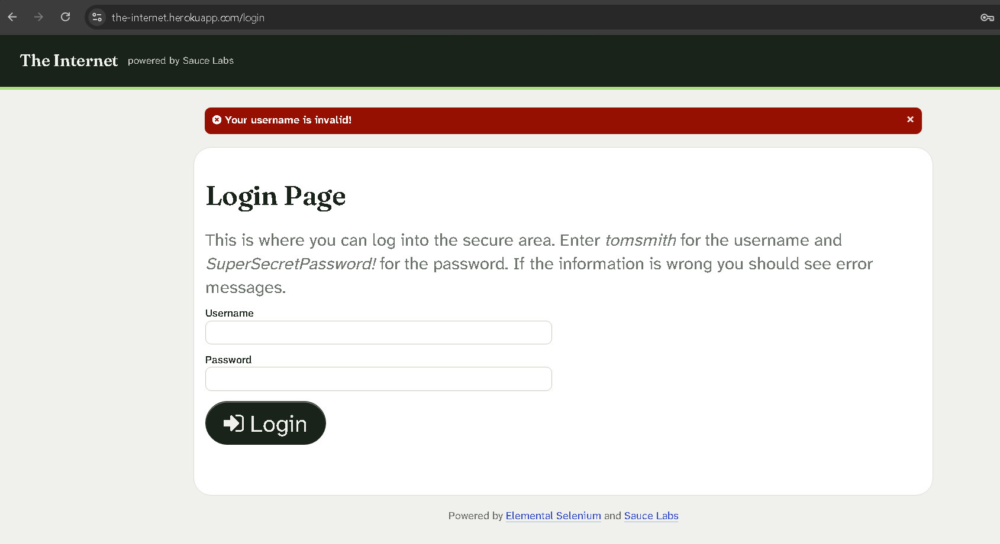
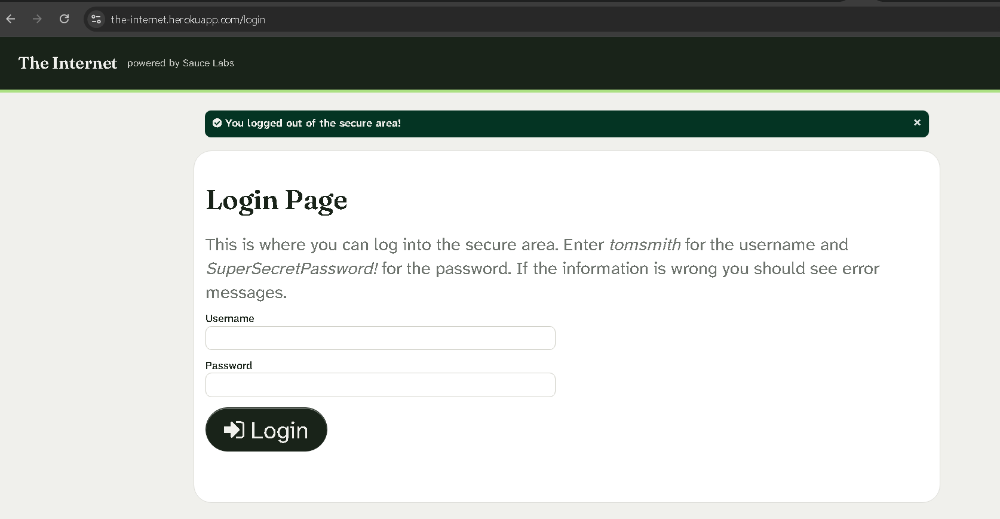

# Test Cases - The Internet - Project 2

## Test 1: Broken Images
- **Steps:** 1. Go to https://the-internet.herokuapp.com 2. Click Broken Images
- **Expected:** All 3 images load correctly
- **Actual:** 2 out of 3 images are broken (show broken image icon), only 1 image (avatar) loads correctly.
- **Result:** FAIL
- **Screenshot:** 

## Test 2: Login - Valid Credentials
- **Steps:** 1. Go to Form Authentication 2. Username: tomsmith 3. Password: SuperSecretPassword! 4. Click Login
- **Expected:** Login succeeds, shows Secure Area page with success message
- **Actual:** Login succeeded, green banner "You logged into a secure area!", page shows "Secure Area" and "Logged in as tomsmith"
- **Result:** PASS
- **Screenshot:** 

## Test 3: Login - Wrong Password
- **Steps:** 1. Go to Form Authentication 2. Username: tomsmith 3. Password: wrongpassword 4. Click Login
- **Expected:** Login fails, shows error "Your password is invalid!"
- **Actual:** Login failed, red banner "Your password is invalid!", stayed on Login Page
- **Result:** PASS
- **Screenshot:** 

## Test 4: Login - Wrong Username
- **Steps:** 1. Go to Form Authentication 2. Username: wronguser 3. Password: SuperSecretPassword! 4. Click Login
- **Expected:** Login fails, shows error "Your username is invalid!"
- **Actual:** Login failed, red banner "Your username is invalid!", stayed on Login Page
- **Result:** PASS
- **Screenshot:** 

## Test 5: Logout
- **Steps:** 1. Login with valid credentials 2. Click Logout in Secure Area
- **Expected:** Logout succeeds, shows "You logged out of the secure area!" and returns to Login Page
- **Actual:** Logout succeeded, green banner "You logged out of the secure area!", returned to Login Page
- **Result:** PASS
- **Screenshot:** 
- **Note:** Login Page displays test credentials (tomsmith / SuperSecretPassword!) - this is intentional on this practice site for testers, not a bug. On a production site this would be a High severity security issue.
