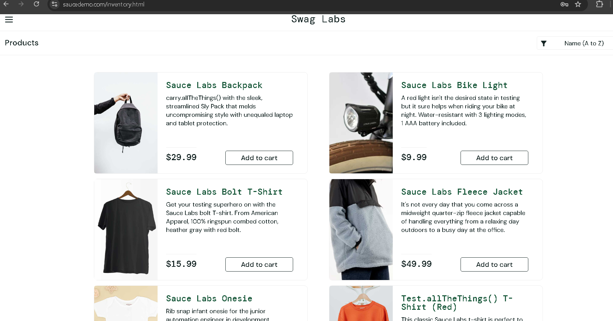
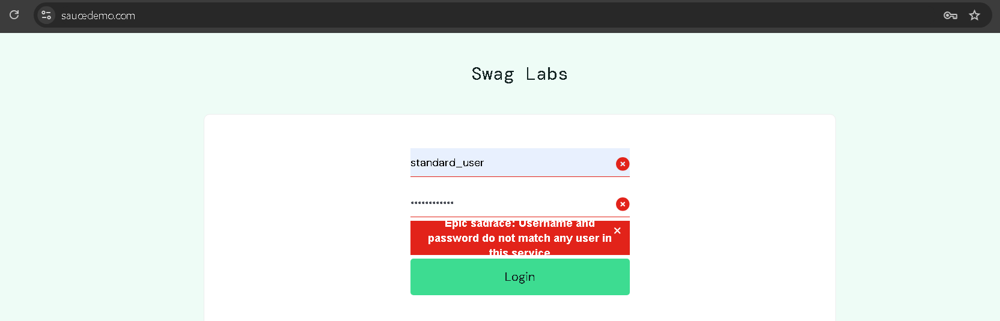
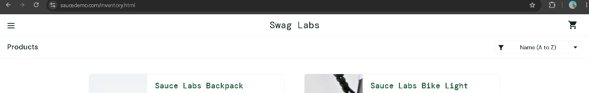
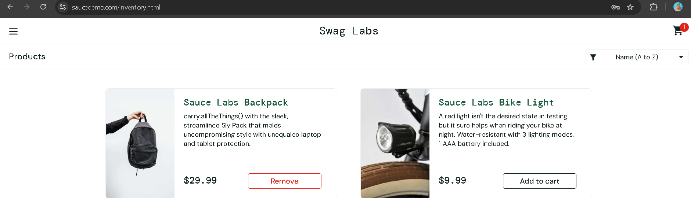
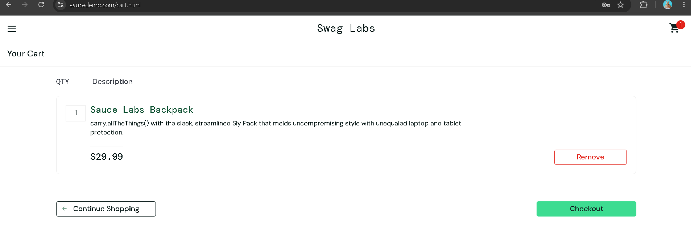
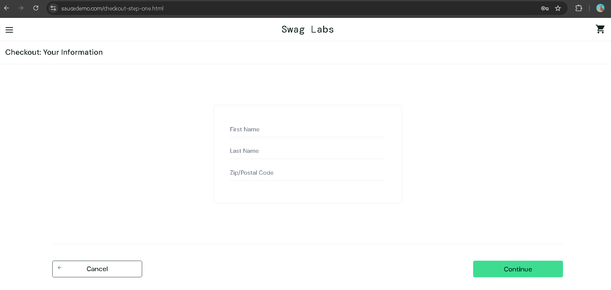

# Test Cases - SauceDemo

## Test 1: Login valid
- **Steps:** 1. Go to saucedemo.com 2. Login: standard_user / secret_sauce
- **Expected:** Products page shows
- **Actual:** Products page displayed with 6 products, Sauce Labs Backpack, Bike Light, Bolt T-Shirt, etc. URL changed to inventory.html
- **Result:** PASS
- **Screenshot:** 

## Test 2: Login wrong password
- **Steps:** 1. Go to saucedemo.com 2. Login: standard_user / wrong 3. Click Login
- **Expected:** Error message shows, stay on login page
- **Actual:** Red error shows "Epic sadface: Username and password do not match any user in this service"
- **Result:** PASS
- **Screenshot:** 

## Test 3: Login enpty
- **Steps:** 1. Go to saucedemo.com 2. Leave username and password empty 3. Click Login
- **Expected:** Error "Username is required"
- **Actual:** Red error shows "Epic sadface: Username is required". Stayed on login page.
- **Result:** PASS
- **Screenshot:** 

## Test 4: Search valid
- **Steps:** Look for search bar on Products page, try to search "Backpack"
- **Expected:** Search bar exists and filters products
- **Actual:** No search bar or search feature found anywhere on Products page
- **Result:** FAIL
- **Screenshot:** 

## Test 5: Search empty
- **Steps:** N/A - No search feature exists
- **Expected:** N/A
- **Actual:** N/A
- **Result:** N/A - Blocked by Test 4

## Test 6: Add to cart
- **Steps:** Click Add to cart on Sauce Labs Backpack
- **Expected:** Cart icon shows 1, button changes to Remove
- **Actual:** Cart icon shows 1, button changed to Remove. Backpack added successfully.
- **Result:** PASS
- **Screenshot:** 

## Test 7: Add 0 quantity
- **Steps:** Try to change quantity of Backpack to 0 or 2
- **Expected:** Can change quantity
- **Actual:** No quantity option exists, can only add 1 of each item
- **Result:** FAIL
- **Screenshot:** 

## Test 8: Checkout empty
- **Steps:** 1. Empty cart 2. Click Checkout
- **Expected:** Blocked, message "Cart is empty"
- **Actual:** Allowed to proceed to Checkout: Your Information page even with empty cart
- **Result:** FAIL
- **Screenshot:** 

